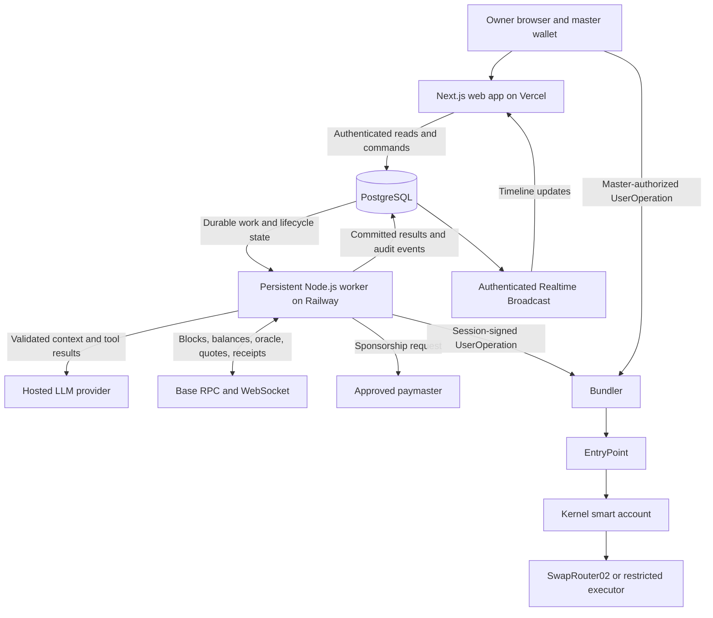
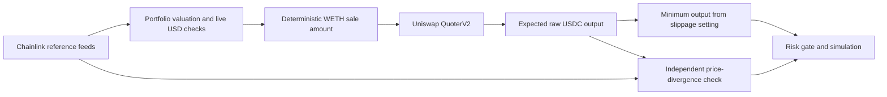

# Guardian Agent — System Architecture

**Status:** Implemented and verified on Base Sepolia (v2: two-way WETH ↔ USDC and multi-asset USDC-hub). Mainnet is disabled in code until the owner approves. Live demo: <https://guardian-agent-murex.vercel.app/> (Judge Sandbox, no wallet needed).

> **Reading note.** Sections 3–15 are the original design and remain the rationale. Where they differ from what was built, the implemented choices in §1–§2 and the "v2 as built" notes win. Evidence: [docs/execution-evidence.md](docs/execution-evidence.md), [docs/security-assessment.md](docs/security-assessment.md), [docs/technical-documentation.md](docs/technical-documentation.md).

**Inputs:** The supplied “Recommended stack” document, including its AI-agent and hosting discussion, and [plan.md](./plan.md).

This document defines component boundaries, data flow, delegated authority, persistence, and deployment. The implementation gates, schedule, demonstration scenarios, and definition of done remain in `plan.md`.

Version families and provider choices below reflect the supplied recommendations, not independently verified availability. Confirm supported versions, compatibility, contract deployments, model IDs, quotas, and pricing during setup. Do not treat the source's “current,” “latest,” or free-tier claims as verified facts.

## 1. Architectural decisions

1. Use TypeScript and pnpm workspaces across the web app, worker, and shared packages.
2. Run the Next.js dashboard separately from the persistent Node.js agent worker.
3. Keep master authority in the owner's wallet and delegate only restricted session authority to the worker.
4. Use an event-driven, tool-using LLM to propose intent. Deterministic modules calculate, validate, construct, and authorize transactions.
5. Use Chainlink reference prices for financial valuation and Uniswap quotes for expected execution output.
6. Use PostgreSQL as the durable source of application state. The dashboard receives committed activity over Server-Sent Events (`/api/stream`), which tails the audit table — no separate realtime service.
7. Prefer direct SwapRouter02 execution only after Gate 0 proves the required field restrictions; otherwise use the minimal executor fallback.
8. Keep the LLM behind a provider adapter and stop new autonomous financial actions when no validated decision is available.

**v2 as built.** The original MVP scope was one strategy (sell overweight WETH into USDC). The implementation now supports:

- **Two-way WETH ↔ USDC rebalancing:** `exactInputSingle` (sell WETH, `amountIn` ≤ compiled cap) and `exactOutputSingle` (buy WETH, `amountInMaximum` ≤ compiled USDC cap).
- **Multi-asset USDC-hub portfolios:** each tradable asset trades only against USDC, through its own isolated session key. An asset is tradable only after four on-chain checks: the token contract, a Chainlink feed, a USDC pool, and a $1 QuoterV2 test swap. Assets without a pool are tracked in simulated paper mode.
- **Partial-Step Autonomy (E7):** a move larger than the per-trade cap, up to 3× the cap, is executed at Tier 1 as one capped step (`PARTIAL_STEP`), then re-evaluated after the cooldown.
- **3-Strike Rule-Based Fallback (E8):** if no model returns a valid decision, the owner's own target is used as a deterministic rule for small, low-risk trades; the 3rd consecutive AI failure pauses autonomy (`AI_UNAVAILABLE_OR_INVALID`).

## 2. Selected stack and its responsibilities

| Layer | Implemented choice | Responsibility |
| --- | --- | --- |
| Language / monorepo | TypeScript, pnpm workspaces | Shared types, policy logic, agent runtime, chain integration |
| Frontend | Next.js 16 App Router, React 19 | Console: overview, portfolio, agent chat, activity, limits, settings |
| UI | Custom glassmorphic CSS modules (`console.module.css` etc.) | Light/dark themes, command palette, no UI framework |
| Wallet connection | Raw EIP-1193 via viem (`components/wallet.ts`), SIWE sign-in | Owner sign-in and exact `userOpHash` signatures; testnet Judge Sandbox login (read-only for owner actions) |
| EVM client | viem | Reads, ABI encoding, event decoding, simulations, receipts, signatures |
| Worker runtime | Node.js | Persistent watcher: polling + WebSocket transfers, reconciliation |
| Account | ZeroDev Kernel v3.3 | ERC-4337 smart account with separate master and session authority |
| EntryPoint | v0.7 (`0x0000000071727De22E5E9d8BAf0edAc6f37da032`) | UserOperation validation and execution |
| Delegation | `@zerodev/permissions`: `CallPolicy` 0.0.5, `TimestampPolicy`, `RateLimitPolicyWithReset`, `GasPolicy` | One session key per tradable asset; caps, recipient lock, op window, expiry, paymaster-only gas |
| Bundler / paymaster | Pimlico | UserOperation submission and sponsorship |
| Networks | Base Sepolia (verified); Base mainnet gated by `GUARDIAN_ALLOW_MAINNET` | Test/security evidence |
| DEX | Uniswap V3 SwapRouter02 | `exactInputSingle` (sell) and `exactOutputSingle` (buy) only |
| Execution quote | Uniswap QuoterV2 | Expected output and quote-derived minimums |
| Reference oracle | Chainlink ETH/USD and USDC/USD (+ per-asset feeds) | Valuation, divergence checks |
| Rebalancing engine | Closed-form integer math (`packages/portfolio`) | Two-way and multi-asset hub legs, no floating point in amounts |
| Database / ORM | PostgreSQL, Drizzle | Policies, sessions, actions, receipts, audit history, durable claims |
| Live UI | Server-Sent Events (`/api/stream`) | Push audit events and worker watch status to the console |
| Counterfactual preview | `/api/whatif` | Replays the last 7 days under proposed limits before saving |
| Validation | Zod | Strict policy and model-output schemas (unknown fields rejected) |
| LLM | Groq `openai/gpt-oss-120b` primary → configurable fallback (Gemini or OpenAI) → deterministic rule fallback | Bounded decisions and explanations |
| Tests | Vitest, Playwright | Finance, policy, risk, schema, lifecycle, dashboard |
| Hosting | Vercel (web), persistent process for the worker | |

Select patched, mutually compatible releases and pin them after Gate 0. Using Pimlico services does not imply self-hosting Alto; choose the actual service endpoint and sponsorship configuration during integration. Preserve a bundler adapter so provider-specific behavior does not spread through the application.

Use viem consistently instead of mixing EVM client libraries. No LangChain, CrewAI, AutoGen, Kafka, RabbitMQ, Elasticsearch, or separate microservice layer is required for the MVP.

## 3. Deployment topology



The database-to-worker arrow represents durable commands claimed by the worker; it is not a requirement for a separate message broker. The database-to-Broadcast arrow represents a configured trigger or publication after a committed change.

A traditional VPS is optional. The requirement is a persistent, restartable worker while autonomous monitoring is enabled. Choose a hosting configuration that stays running; do not assume every hosting tier provides that behavior.

Next.js handlers serve bounded requests. They do not run the infinite blockchain listener. The browser does not need to stay open for Tier 1 actions, but owner interaction is required for master authorization and Tier 2 signing.

## 4. Application and package boundaries

### Web application

`apps/web` owns wallet connection, policy editing, account/session setup screens, pending approvals, revocation controls, portfolio display, and the audit timeline.

Short-lived server handlers authenticate requests, validate ownership, and persist commands or return state. Treat a wallet address as an identifier, not proof of authentication: use a verified wallet-signature login challenge bound to a session, including replay protection.

The web application never receives the agent's decrypted key. Master signatures are requested from the connected owner wallet. An approval stored in PostgreSQL is not itself on-chain master authorization.

### Persistent worker

`apps/worker` owns:

- Block/event subscriptions, reconnect handling, and missed-block reconciliation.
- Cheap portfolio prechecks and meaningful-event detection.
- Durable action claiming and one-active-rebalance enforcement.
- LLM tool orchestration and output validation.
- Deterministic planning, quotes, risk checks, and simulation.
- Tier 1 session signing and UserOperation submission.
- Creation of Tier 2 approval requests without access to the master private key.
- Receipt tracking, outcome verification, and audit persistence.

### Shared package responsibilities

| Package | Owns | Boundary |
| --- | --- | --- |
| `chain` | viem clients, network configuration, verified addresses and ABIs | No user policy decisions |
| `account` | Kernel setup, permissions, signer interfaces, UserOperation lifecycle | No model-controlled authority changes |
| `portfolio` | Balances, valuation, allocation, closed-form rebalance calculation | No floating-point transaction amounts |
| `oracle` | Feed reads, decimals, timestamps, freshness validation | No use of DEX quotes as the only USD reference |
| `dex` | QuoterV2 calls, quote metadata, exact swap encoding | Only configured assets, router, and fee tier |
| `policy` | Human policy validation, compiler, live checks, authority routing | No implicit expansion of delegated permission |
| `risk` | Deterministic score, reference-price divergence, decision thresholds | No LLM-generated risk score |
| `agent` | Provider adapters, tool registry, bounded orchestration, intent schema | No transaction signing or unrestricted RPC tools |
| `simulation` | `eth_call`, gas estimation, predicted effects | Simulation is not a substitute for permission validation |
| `audit` | Event types, correlation IDs, evidence serialization | No keys or provider credentials in logs |
| `db` | Drizzle schema, migrations, repositories, action claims | Durable state remains authoritative over UI broadcasts |

## 5. Agent loop and tool interface

```text
OBSERVE → LOAD CONTEXT → USE TOOLS → DECIDE
    → VALIDATE INTENT → PLAN → QUOTE → RISK → SIMULATE
    → ROUTE AUTHORITY → ACT → VERIFY → RECORD → OBSERVE
```

### Event-driven invocation

The watcher performs inexpensive deterministic checks on new blocks and relevant events. Wake the LLM only for meaningful changes: incoming WETH, allocation threshold crossing, material price movement, policy updates, failed transactions, security events, or user messages.

Debounce repeated events and respect cooldowns and active actions. A block notification alone does not justify an LLM request.

### Bounded tools

| Tool | Purpose |
| --- | --- |
| `get_portfolio` | Current balances, USD values, weights, snapshot block |
| `get_policy` | Owner-approved financial policy and active version |
| `get_market_prices` | Validated reference prices and freshness |
| `get_recent_transactions` | Recent account execution outcomes |
| `get_agent_history` | Prior decisions, pending actions, cooldown context |
| `get_gas_conditions` | Validated execution-cost and sponsorship context |
| `get_risk_summary` | Deterministic risk context with provenance |
| `get_quote` | Read-only quote for a deterministically validated candidate |

Tool access is scoped to the authenticated account and policy. Validate arguments, limit tool rounds and runtime, and never expose arbitrary transaction execution, signing, shell access, or general contract calls to the model. Quote tools cannot accept arbitrary token or router addresses from the model.

Record tool names, validated inputs/results, and a concise decision explanation. Hidden model reasoning is not required for the audit trail.

### Decision contract

Use `decision` as the canonical field across providers; normalize the earlier plan's illustrative `action` field at the adapter boundary if necessary.

```ts
type AgentDecision =
  | {
      decision: "REBALANCE";
      targetWethWeight: number;
      reason: string;
    }
  | {
      decision: "WAIT" | "ESCALATE" | "NO_ACTION";
      reason: string;
    };

interface AgentModel {
  decide(context: AgentContext): Promise<AgentDecision>;
}
```

Implement this as a strict Zod discriminated union. Limit explanations to 500 characters, reject unexpected fields, and require the rebalance target to equal the approved policy target. A number between 0 and 1 is structurally valid but is not automatically authorized.

| Decision | Meaning |
| --- | --- |
| `REBALANCE` | Propose the approved strategy; deterministic checks decide execution eligibility |
| `WAIT` | Defer with a reason; deterministic scheduling decides when to reconsider |
| `ESCALATE` | Request owner attention; any financial action still needs planning, validation, and master signing |
| `NO_ACTION` | Record that no financial action is proposed |

The agent may interpret natural-language goals into a structured policy proposal. Such a proposal is inactive until the owner reviews it and authorizes any required permission change. The LLM cannot change spending caps, session permissions, or the active strategy by editing its output.

## 6. LLM providers, availability, and cost

```text
AgentModel
    ├── GeminiProvider — proposed primary hosted provider
    ├── OpenAIProvider — proposed hosted fallback
    └── OllamaProvider — optional local development adapter
```

The supplied text names “Gemini 3.8 Flash” and “GPT-6 Luna” and includes specific pricing/free-tier claims. Treat those as unverified source candidates, not selected API model IDs. Configure actual model IDs only after checking availability, tool support, structured output, quotas, latency, and cost.

Proposed configuration interface:

```dotenv
LLM_PROVIDER=gemini
LLM_MODEL=<verified-primary-model-id>
LLM_FALLBACK_PROVIDER=openai
LLM_FALLBACK_MODEL=<verified-fallback-model-id>
```

Implement one provider first behind the adapter, then validate the fallback against the same contract before the demo. A fast model with reliable tools and structured output is sufficient; market prediction and runtime code generation are outside the task.

A paid API is not an architectural requirement. A suitable free quota or local model can serve development, but no zero-cost deployment is guaranteed. Hosting, RPC, sponsorship, mainnet funds, and fallback credits are separate budget items. Cap request rate, context size, tool rounds, and retries.

If the primary provider fails, a configured fallback may attempt the same bounded decision. If neither produces a valid response, pause new autonomous financial actions and alert the owner. Continue tracking already-submitted operations and serving revocation controls. Provider retries must not create additional execution attempts.

### Ollama topology

Local development may run both the worker and Ollama on the same machine. A cloud worker's `localhost` refers to that cloud environment, not a developer's laptop.

Using Ollama remotely requires a reachable, authenticated model service or colocated infrastructure. Keep it optional for the MVP and benchmark the actual chosen model's tool/schema behavior. Local inference avoids per-token API billing but still requires hardware and uptime; a GPU/VPS is not required for the proposed hosted-LLM deployment.

## 7. Independent valuation and execution pricing



Read ETH/USD as the proposed WETH valuation proxy and USDC/USD for USDC valuation. Document the WETH/ETH parity assumption and verify feed addresses, decimals, freshness limits, and network availability. Include applicable L2 sequencer-availability checks in the oracle integration design.

Reject missing, invalid, or stale prices. A testnet fixture or substituted feed must be explicitly labeled and cannot silently stand in for a verified mainnet source.

Financial calculation:

```text
V_total = V_WETH + V_USDC
saleUsd = V_WETH - targetWeight × V_total
amountInWeth = saleUsd / wethUsdPrice
```

Transaction construction uses integer token units: 18 decimals for WETH, 6 for USDC. Normalize oracle decimals with explicit fixed-point arithmetic and rounding.

Execution protection:

```text
minOutRaw = floor(quoteOutRaw × (10000 - maxSlippageBps) / 10000)
```

Record quote block/time, input, output, pool, and fee tier. Define quote freshness and price-divergence thresholds during Gate 0. Excessive divergence must block or require approval according to deterministic risk rules.

## 8. Authority and signing architecture

```text
AgentPermission = restricted session signer
                + call restrictions
                + timestamp restrictions
                + operation-count restrictions
                + gas/paymaster restrictions
```

This is an intended composition, subject to the actual SDK and deployment tests. Gate 0 must prove both allowed and forbidden behavior.

### Policy compilation

```text
maxAmountInWei = floor(
  maxAutoTxUsd / (authorizationWethUsdPrice × (1 + buffer)) × 10^18
)
```

Persist the policy version, price evidence, buffer, token ceiling, expiry, count limit, target, selector, assets, recipient rule, paymaster, and permission identifier.

| Layer | Enforcement |
| --- | --- |
| Application | Live USD transaction cap, daily USD ledger, oracle/quote freshness, risk, cooldown |
| Smart-account permission | Verified token-unit cap, allowed calls/assets/recipient, time, count, gas/paymaster limits |
| Token allowance | Bounded spender exposure authorized by the master |
| Swap execution | Submitted minimum output |

Token-unit ceilings do not remain exact USD caps as prices move. Daily USD accounting and dynamic market-quality checks remain off-chain. A backend that can choose an unconstrained minimum output may choose poor execution terms within its bounded token authority. Preserve these limitations in the security report.

### Authority routing

| Route | Conditions | Signer |
| --- | --- | --- |
| Tier 1 | All live policy, compiled permission, budget, gas, count, expiry, and LOW-risk checks pass | Restricted session signer |
| Tier 2 | Otherwise valid action exceeds agent authority or requires review | Master wallet after explicit approval |
| Tier 3 | Prohibited target/action, invalid permission attempt, malicious parameters, or HIGH risk | None; reject |

The worker cannot execute Tier 2 using its session key. Revalidate balances, quotes, policy version, and simulation after delayed approval, then request the owner's signature on the actual reviewed operation. If material terms change, present them again. Never turn a prohibited session attempt into an automatic master action.

### Router versus fallback

Direct path: smart account → SwapRouter02 `exactInputSingle`, using the seven-field tuple without `deadline`.

Fallback path: smart account → `GuardianSwapExecutor.swapWethToUsdc(amountIn, amountOutMinimum)` → SwapRouter02.

The fallback fixes assets, router, fee tier, and recipient logic; constrains caller/funding behavior; and uses bounded approvals. It requires contract tests and review. It does not solve USD or dynamic pricing enforcement by itself.

During authorization, the master grants only a bounded WETH allowance to the actual spender, sized against session exposure. The agent cannot grant unlimited approvals. The master can revoke the permission and optionally clear the allowance.

## 9. Persistence and realtime delivery

| Table | Key information |
| --- | --- |
| `users` | Application identity and verified owner-wallet association |
| `smart_accounts` | Owner, chain, account, Kernel/EntryPoint configuration |
| `agent_sessions` | Permission ID, signer address, encrypted key material, expiry, revocation state |
| `policies` | Versioned owner-approved human policy |
| `policy_compilations` | Authorization prices, buffer, compiled restrictions, policy/session references |
| `agent_actions` | Trigger, decision, policy version, state, approval requirement, budget reservation, cooldown |
| `user_operations` | Action reference, nonce, authority path, operation hash, submission state, bundler result |
| `transactions` | Chain, transaction hash, block, receipt status, actual effects |
| `security_events` | Attempted violation, reason, source, validation evidence |
| `audit_events` | Ordered lifecycle events, timestamps, correlation IDs, sanitized evidence references |

Include chain and account scope on applicable records. Keep token amounts lossless in the database and serialize big integers as strings at JSON boundaries. Link each action to the exact policy/compilation used.

Use database transactions and a durable account/action claim to prevent duplicate processing. Claim actions and reserve budget atomically. Reconcile reservations with confirmed outcomes or definitive failures; an uncertain submission is not a definitive failure.

Publish realtime notifications after state is committed. Scope channels and row access to the authorized user/account. On reconnect, the dashboard reloads persisted events after its last cursor; Broadcast is not the only copy of history.

## 10. Action lifecycle and recovery

```text
IDLE → TRIGGERED → PLANNING → SIMULATING
    ├── Tier 1 → SUBMITTING → PENDING → CONFIRMED → COOLDOWN → IDLE
    ├── Tier 2 → PENDING_APPROVAL → REVALIDATING → MASTER_SIGNING
    │                                      → SUBMITTING → PENDING
    └── Prohibited → REJECTED
```

Also represent `WAIT`, `NO_ACTION`, `FAILED`, `PAUSED`, and `SESSION_REAUTH_REQUIRED` explicitly where appropriate. A pending approval or uncertain submission remains active until resolved or safely cancelled.

Persist submission intent, nonce, and operation identity before external submission when possible. If a timeout leaves the result unknown, reconcile by operation hash, account nonce, bundler state, and chain evidence before retrying. Do not assume an RPC timeout means nothing was submitted.

On worker restart, recover active actions and watcher checkpoints before accepting new rebalances. Reconnect WebSocket subscriptions and backfill missed blocks. Define confirmation and reorg handling before classifying an action as final.

Compare actual balances and receipts with expected results. A successful outer ERC-4337 transaction does not by itself prove that every included UserOperation executed successfully.

## 11. Secrets and trust boundaries

- The owner wallet keeps the master private key; the worker never receives it.
- Store session private keys as authenticated encrypted blobs, not plaintext PostgreSQL fields.
- Keep the encryption secret only in the worker's secret environment, with key-version metadata for rotation.
- Decrypt session material only when needed by the signer; exclude it from prompts, responses, logs, error payloads, and broadcasts.
- Keep database service credentials, LLM keys, RPC secrets, and paymaster credentials server-side and outside `NEXT_PUBLIC_*` variables.
- Restrict browser data access through authenticated ownership checks and appropriate row/channel policies.
- Redact sensitive request fields before Pino/Sentry ingestion.

Database encryption protects stored key material from a database-only disclosure. A compromised worker may still use its session authority. Independent on-chain restrictions are therefore the primary boundary against unrestricted spending. A KMS/HSM-backed signer is a future hardening option.

An append-only application audit convention improves traceability but does not make a compromised database tamper-proof. Preserve chain-backed evidence separately from application claims.

## 12. Failure behavior

| Failure | Required behavior |
| --- | --- |
| LLM timeout, invalid output, or unavailable providers | Pause new autonomous financial actions; log and notify |
| Stale/missing price feed | Block valuation-dependent planning and authorization |
| Missing/stale quote or excessive divergence | Refresh or reject according to deterministic rules |
| Simulation failure | Do not submit; record the revert/classification |
| Paymaster unavailable or unapproved | Do not silently spend account ETH through the agent |
| RPC/WebSocket interruption | Reconnect/backfill; avoid acting on unverified stale state |
| Bundler rejects validation | Record rejection without inventing a transaction hash |
| Submission timeout | Reconcile; keep the active-action lock |
| Permission expired or revoked | Block session execution; surface owner reauthorization if appropriate |
| Database unavailable | Stop new actions that cannot be durably coordinated |
| Realtime disconnected | Dashboard reloads persisted state when connectivity returns |

Failure handling must preserve monitoring of already-submitted transactions wherever dependencies permit. Alerts and failures are audit events, not new authority grants.

## 13. Repository layout and relationship to the plan

This refines the earlier illustrative repository layout: `apps/worker` replaces the proposed long-running `apps/api`; `chain` replaces `blockchain`; `dex` combines quote and swap integration; `oracle` and `db` become explicit packages. Short request APIs live in the Next.js application. The root `architecture.md` is the architecture reference for now.

```text
guardian-agent/
├── apps/
│   ├── web/
│   └── worker/
├── packages/
│   ├── chain/
│   ├── account/
│   ├── portfolio/
│   ├── oracle/
│   ├── dex/
│   ├── policy/
│   ├── risk/
│   ├── agent/
│   ├── simulation/
│   ├── audit/
│   └── db/
├── contracts/
│   ├── src/       # GuardianSwapExecutor only if fallback is needed
│   ├── test/
│   └── script/
├── scripts/
│   ├── create-account.ts
│   ├── authorize-agent.ts
│   ├── trigger-demo.ts
│   ├── malicious-userop.ts
│   └── direct-handleops.ts
├── tests/
│   ├── unit/
│   ├── integration/
│   ├── security/
│   └── e2e/
├── docs/
├── plan.md
├── architecture.md
└── README.md
```

This tree is a proposed structure, not a list of already-created files.

## 14. Testing and observability

| Tool / layer | Verification |
| --- | --- |
| Vitest | Compiler rounding, USD/token boundaries, allocation math, quote minimums, risk, strict schemas, authority routing |
| Worker integration tests | Durable claims, budget reservations, duplicate events, restart recovery, provider fallback, unknown submissions |
| Foundry | Executor invariants if used, fork behavior, malicious-call cases, direct EntryPoint attack harness |
| Testnet integration | Real account/session setup, allowed operation, forbidden target/selector/asset/recipient/amount, expiry, count, revocation, gas policy |
| Playwright | Owner setup, policy review, timeline, Tier 2 master approval, revocation and evidence links |
| Small mainnet proof | Real autonomous swap and accurate receipt/balance verification |

Keep three evidence classes separate: application rejection, bundler validation rejection without a broadcast transaction, and forced on-chain validation failure using the testnet-only `handleOps` harness. Distinguish execution reverts from authorization failures.

Correlate Pino logs, persisted audit events, and Sentry errors using account, chain, action ID, policy version, permission ID, UserOperation hash, and transaction hash when available. Track watcher lag, provider failures, simulation failures, pending-operation age, worker heartbeat, and permission expiry.

The dashboard displays the master owner, smart account, session signer, EntryPoint, permission ID/expiry, UserOperation hash, and transaction hash separately. Do not label the session signer as the conventional explorer transaction sender.

## 15. Pre-implementation verification checklist

- [ ] Resolve compatible Node.js, Next.js, React, wallet, Kernel, permission SDK, and EntryPoint versions.
- [ ] Verify per-network RPC, router, QuoterV2, tokens, oracle feeds, decimals, pool liquidity, and fee tier.
- [ ] Prove direct-router nested-field restrictions or select the executor fallback.
- [ ] Verify timestamp, count-window, revocation, gas, and required-paymaster enforcement.
- [ ] Configure the actual bundler and sponsorship service, including funding and quotas.
- [ ] Select available primary/fallback model IDs and validate tool/schema behavior.
- [ ] Define oracle/quote freshness, price divergence, reauthorization, cooldown, and confirmation thresholds.
- [ ] Define the daily-budget window, valuation semantics, reservations, and reconciliation behavior.
- [ ] Finalize authentication, database access, private realtime channels, and encrypted session-key storage.
- [ ] Confirm persistent worker hosting, restart behavior, health checks, and budget.
- [ ] Record all resolved choices in configuration and deployment documentation before implementing dependent paths.

Gate 0 resolves integration uncertainty. Gates A–D in [plan.md](./plan.md) then establish account security, real swaps, autonomous execution, and independently enforced session boundaries.
